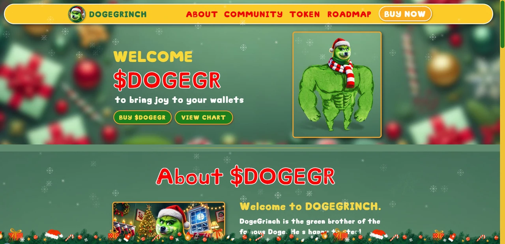

# DogeGrinch - промосайт проекта

**Автор проекта:** [Евгений Толмачев](https://github.com/EvgenyET) · [Страница проекта в портфолио](https://evgeny-dev.pro/project/DogeGrinch_site/dogegrinch_site.html)

Бренд-сайт DogeGrinch с историей проекта, фирменной графикой и ссылками для участников.

## Мой вклад

Разработал дизайн и фронтенд промосайта. Выстроил страницу от знакомства с персонажем до дорожной карты и ссылок сообщества. Адаптировал композицию и иллюстрации для телефона.

## Интерфейс

**Первый экран промосайта на компьютере**

**Дорожная карта в мобильной версии**

## Как это работает

Лендинг знакомит посетителя с персонажем DogeGrinch и ведёт от первого экрана к информации о проекте и сообществе. На мобильном экране иллюстрации и блоки текста перестраиваются в одну колонку.

## Возможности

- Информационные разделы на одной странице.
- Иллюстрации, локальные шрифты и адаптивное оформление.
- Переходы к ресурсам проекта и сообщества.

## Технологии

HTML5, CSS3, JavaScript (ES6), Webpack, Responsive Design, SEO, UI/UX, Design.
