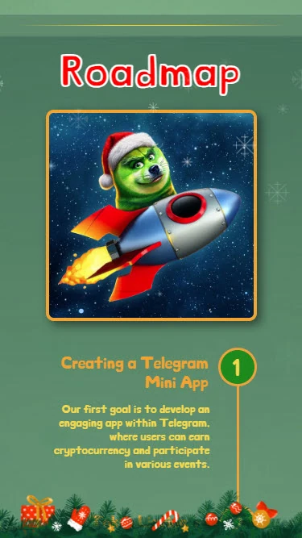

# DogeGrinch - промосайт проекта

Автор проекта - **Евгений Толмачев**. [Профиль GitHub](https://github.com/EvgenyET) · [Проект в портфолио](https://evgeny-dev.pro/project/DogeGrinch_site/dogegrinch_site.html)

Адаптивный промосайт DogeGrinch с персонажем, историей проекта, токеномикой и дорожной картой. Иллюстрированные разделы ведут к сообществу и ресурсам проекта.

## Задача проекта

Задача сайта - представить проект человеку, который впервые о нём слышит. В работе важны последовательность разделов, различимость основных действий и единый характер графики и типографики на широком и узком экране. В сохранённой странице используются элементы и скрипты Tilda.

## Мой вклад

Оформил страницы и информационные разделы в стиле DogeGrinch, настроил расположение иллюстраций, заголовков и внешних переходов. Доработал адаптивное представление и типографику, подключил локальные шрифты и проверил отображение тематических надписей в браузере.

## Интерфейс

**Первый экран промосайта на компьютере**

**Дорожная карта в мобильной версии**

## Как работает приложение

Промосайт знакомит посетителя с DogeGrinch через персонажа, тематическую графику и последовательность информационных разделов. После первого экрана можно изучить идею проекта, распределение токена и план развития, затем перейти к сообществу. Для телефона подготовлена вертикальная композиция, в которой иллюстрации и текст сохраняют порядок чтения.

## Возможности

- Первый экран с персонажем и основным действием для посетителя.
- Разделы об идее проекта, токеномике и плане развития.
- Адаптивные блоки с отдельным расположением графики на телефоне.
- Локальные шрифты и единое оформление заголовков и кнопок.
- Появление элементов при прокрутке и отложенная загрузка изображений.
- Переходы в сообщество и к внешним ресурсам проекта.

## Техническое устройство

### Страница

Главная страница соединяет знакомство с персонажем, описание проекта, дорожную карту и внешние ссылки. Порядок разделов сохраняется и на узком экране.

### Оформление

Сетка, локальный шрифт и тематические фоновые изображения задают композицию каждого раздела. На мобильной ширине текст и графика перестраиваются под вертикальную прокрутку.

### Эффекты

Скрипты в js отвечают за появление элементов и отложенную загрузку изображений. Это особенно заметно в длинных иллюстрированных разделах при первом просмотре.

## Технологии

| Технология | Роль в проекте |
| --- | --- |
| HTML и CSS | Адаптивная компоновка страницы. |
| JavaScript | Появление блоков и поведение элементов. |

## Демонстрация

На странице портфолио доступны описание, галерея и видеодемонстрация проекта. [Открыть DogeGrinch - промосайт проекта](https://evgeny-dev.pro/project/DogeGrinch_site/dogegrinch_site.html).
